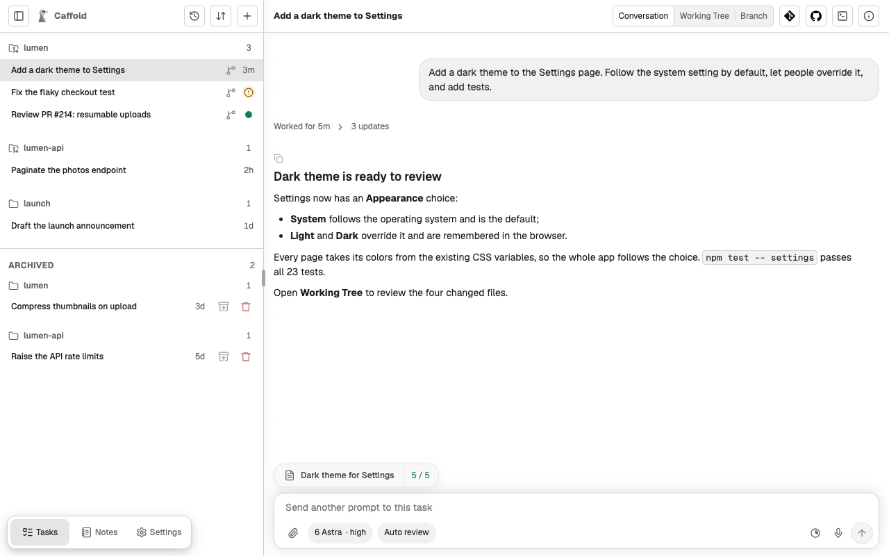
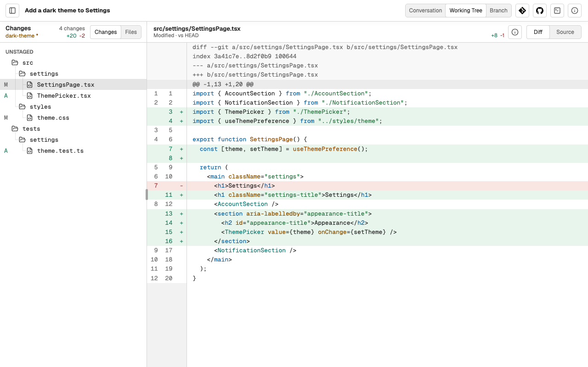

# Caffold

Caffold is a self-hosted workspace for running and reviewing coding-agent work
from any screen. Keep Codex, Claude Code, Grok, or Antigravity working on a Mac
or Linux machine you control, then follow the conversation, answer approvals, inspect commands and tests, and read
the actual files and diff from a desktop, foldable, tablet, or phone.

The user manual is at [caffold.dev](https://caffold.dev).

The layout adapts to the screen; the workflow stays the same. A Task still
contains one agent conversation and the repository context needed to judge its
work. Start on one device, leave the turn running on the host, and return from
another to decide what happens next by text or voice.

Caffold is not a hosted agent or a replacement harness. The agent CLIs,
repositories, credentials, conversations, and execution remain on your host.

## What it looks like



_Follow a Task as it runs, then read the result and decide what comes next._



_Open Working Tree to review the actual files and diff without leaving the
Task._

_These images show a Codex Task. The other agents use the same
Conversation and review workspace._

## One workspace, native agents

When you create a Task, choosing a model also chooses the agent that provides
it. Caffold currently supports:

- **Codex**, through its persistent app-server runtime;
- **Claude Code**, through its CLI protocol and a Caffold runner that keeps the
  CLI process attached while the backend is replaced;
- **Grok**, through the Grok CLI's leader process and stdio agent protocol,
  with a leader Caffold starts for itself that holds sessions across backend
  replacement; and
- **Antigravity**, through its official ACP agent, with a dedicated Caffold
  runner and the native conversation store.

A Task remains bound to that agent for its lifetime. Its model, reasoning or
effort choices, permission modes, tools, session behavior, and transcript come
from the selected agent rather than from a Caffold reimplementation.

This is deliberate. A coding agent is the model together with the harness its
authors built around it. Caffold gives Codex, Claude, Grok, and Antigravity separate native
drivers so it can preserve those harnesses instead of forcing them through a
lowest common denominator. It normalizes only the product concepts the workspace must
present consistently: conversations, turns, activity, approvals, and the
operations a Task can actually perform.

See [Agent runtimes](docs/architecture/agent-runtimes.md) for the design and the
different state, transport, and recovery boundaries.

## How it works

Only one machine does the actual work: the Caffold host, the Mac or Linux
machine that has the agent CLIs, Git, and your checkouts. On a Mac,
`Caffold Server.app` stays in the menu bar and keeps the Caffold backend
available; on Linux, a systemd user service does. The backend connects the
browser interface to the selected agent and the files on the host.

```text
                    browser or installed PWA
               (desktop, foldable, tablet, phone)
                                |
                      local URL or private
                       Tailscale HTTPS URL
                                |
                    Caffold server on the host
                                |
        +---------------+-------+-------+---------------+
        |               |               |               |
   Codex proxy    Claude runner    Grok bridge     ACP runner
  -> app-server   -> claude CLI     -> leader    -> Antigravity
        |               |               |               |
        +---------------+-------+-------+---------------+
                                |
                   Git checkouts and worktrees
```

On the host, Caffold is at its local address. On another device,
Tailscale Serve can provide a private HTTPS address. Configure and copy that
address from **Settings → Remote Access**; the ready page also provides a QR
code for another permitted device.

Each browser or installed PWA is a window onto the same host, not another copy
of the server. Closing it does not end a turn, but the host must stay awake,
running Caffold, and reachable for remote use.

## A typical Task

1. Start a Task in the directory where the work belongs and choose a Codex,
   Claude, Grok, or Antigravity model.
2. Follow the conversation and answer the agent's approval requests while it
   works.
3. Read the result, command and test output, changed files, and actual diff.
4. Type or dictate the next instruction, steer an active turn, or return later
   and continue the same Task.

For longer turns, each browser can opt in to system notifications under
**Settings → Notifications**, for a turn that ends and for a Task waiting on an
approval.

Caffold also keeps the Task connected to its repository, optional managed
worktree, Git history, and read-only GitHub Issue or Pull Request context. When
you want to check something yourself, each Task and Section has a terminal in
its working directory that keeps running on the host while you move between
devices.

## Install

Caffold runs on Apple silicon Macs with macOS 14 or later, and on x86_64 and
aarch64 Linux with glibc 2.28 or later and systemd. Install and sign in to at
least one supported agent on the host:

- the official standalone Codex CLI `0.155.1` or newer;
- Claude Code `2.1.259` or newer, available as `claude` on Caffold's `PATH`; or
- the Grok CLI `1.0.30` or newer, available as `grok` on Caffold's `PATH` or
  at `~/.grok/bin/grok` or `~/.local/bin/grok`; or
- Antigravity CLI `1.5.1` or newer, available as `agy` on Caffold's `PATH`
  or at `~/.local/bin/agy`, installed and signed in separately.

Any of them may be installed, and Caffold will offer the models it can reach.
[Set up your agents](website/docs/get-started/agents.md) in the user manual has
the agent-specific setup.

On a Mac, install Caffold with Homebrew, launch `Caffold Server` from
Applications, then choose `Open Caffold` from its menu-bar menu:

```sh
brew install --cask panarch/tap/caffold
```

On Linux, the install script installs Caffold for your user and runs it as a
systemd user service:

```sh
curl -fsSL https://caffold.dev/install.sh | sh
```

[Install](website/docs/get-started/install.md) in the user manual has the
details for both.

## With or without a keyboard

Every action in Caffold works from the keyboard. If one doesn't, that's a bug.
Press `F` and a short code appears on each action in view; `S` does the same
for areas that scroll, and key combinations reach the terminal, the side panel,
and those codes even while you type. See
[Keyboard navigation](website/docs/keyboard.md).

You can also work without one. The Task composer supports multilingual voice
input. Under **Settings → Voice Input**, choose Whisper to transcribe on the
host after a one-time model download (about 1.5 GiB), or OpenAI, Gemini, or
Grok to transcribe with your own API key. Audio goes from the browser to the
host, which transcribes it or forwards it to the chosen provider; Caffold never
stores the recordings.

Voice is useful here for the same reason the browser interface is useful: much
of the work is giving direction, reading what happened, and following up.

## Current limits

Caffold assumes one trusted user, one trusted host, and a private network. It
does not provide authentication for a public deployment or multi-user
authorization.

Agent support is built in rather than loaded as a runtime plugin. Caffold
drives the four built-in agents, and each Task keeps its agent.
[Continue with another agent](docs/product/workflows.md#continue-with-another-agent)
opens a separate Task at the same files.
All four agents support steering while a turn runs.

Its Git and GitHub views are deliberately review-oriented. Caffold does not
provide a full editor, and it does not expose stage, commit, checkout, merge,
rebase, reset, stash, publication, or review mutation controls. Those
operations can still be requested through the Task's agent, typed into the
Task's terminal, or performed with the developer tools you already use. Each
Task keeps one terminal, which ends when the Caffold backend stops.

Managed-worktree preparation is explicit, and Caffold only cleans up worktrees
that it created and recorded. The complete implemented scope and limitations
are tracked in [Current Product Status](docs/product/status.md).

## Documentation and development

- [User manual](https://caffold.dev), with its pages in
  [website/docs](website/docs/get-started/how-caffold-works.md), starting with
  [Install](website/docs/get-started/install.md)
- [Product vision](docs/product/vision.md)
- [Current product status](docs/product/status.md)
- [Product workflows](docs/product/workflows.md)
- [Agent runtime architecture](docs/architecture/agent-runtimes.md)
- [Roadmap](docs/product/roadmap.md)
- [Contributing](CONTRIBUTING.md)
- [Testing](docs/development/testing.md)

The complete [documentation index](docs/README.md) groups product,
architecture, development, review, and maintainer material by purpose. Caffold
is available under the [Apache License 2.0](LICENSE).
