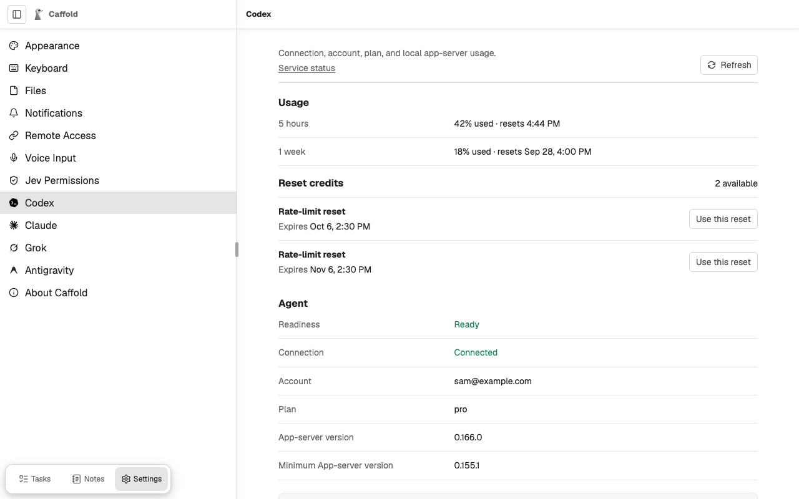
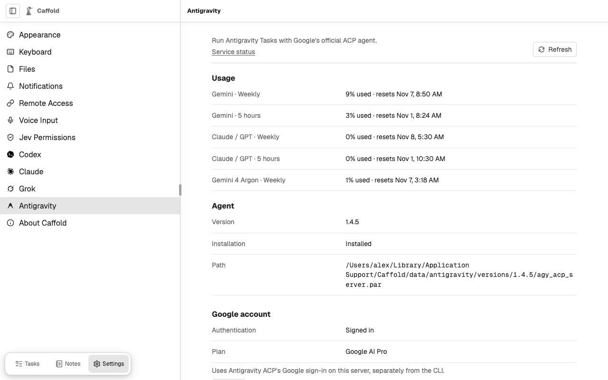

# Set up your agents

Set up at least one supported coding agent on the Mac. New Task offers the
models of every agent
Caffold can reach.

Caffold uses each agent's own sign-in. It never reads or stores your agent
credentials. Codex, Claude Code, and Grok are installed separately;
Antigravity ACP is installed from Caffold Settings.

## Codex

Caffold supports the official standalone Codex CLI `0.155.1` or newer,
installed at `~/.local/bin/codex`. A Codex installed another way, for example
with Homebrew, is reported as unsupported. Install it, then run `codex` once
and complete sign-in:

```sh
curl -fsSL https://chatgpt.com/codex/install.sh | sh
codex
```

Caffold uses the CLI to start and connect to the App-server. The App-server
package is managed separately and can have a different version from the CLI.

**Settings → Codex** reports whether Codex is installed, signed in, and ready,
and says how to fix it when it is not. A Codex problem blocks only Codex: your
existing Tasks stay readable, and other agents keep working.



Codex's own automatic updates restart it in the middle of running work, so
Caffold turns them off unless you have set them yourself in Codex's settings.
Update Codex from **Settings → Codex** instead; see
[Updates](../reference/updates.md#codex).

## Claude Code

Caffold supports Claude Code `2.1.259` or newer. Install it with its official
setup, run `claude` once, and complete sign-in. Caffold looks for `claude` on
its `PATH`, which includes `~/.local/bin`, `/opt/homebrew/bin`, and
`/usr/local/bin`.

**Settings → Claude** shows your usage as Claude reports it, the version and
path Caffold found, the signed-in account and plan, and the state of Caffold's
runner, a small process that keeps Claude Code sessions going while the
Caffold server restarts. When a Claude operation cannot run, the Task shows
Claude's own error.

## Grok

Caffold supports the Grok CLI `1.0.30` or newer. Install it with its official
setup, run `grok` once, and complete sign-in. Caffold looks for `grok` on its
`PATH` and at `~/.grok/bin/grok` and `~/.local/bin/grok`.

The first time Caffold needs Grok, it starts a Grok background process of its
own, which **Settings → Grok** shows as its **Leader**. The leader keeps Grok
turns running while the Caffold server restarts, and it stays running after
Caffold quits. **Settings → Grok** also shows your usage, the version and path
Caffold found, and the signed-in account.

## Antigravity

Open **Settings → Antigravity** and choose **Install Antigravity**. Caffold
installs the supported official ACP agent on the Mac; the separate `agy` CLI
is not required and its sign-in is separate.

1. Choose **Refresh** to check an existing ACP sign-in. If sign-in is needed,
   choose **Sign in**.
2. When **Continue with Google** appears, open it on the device you are using
   and finish Google sign-in.
3. Copy the complete final URL from the browser's address bar, even if its
   localhost page cannot open. Paste it into **Google completion URL** in
   Caffold and choose **Finish sign-in**.
4. Choose **Refresh** to load the account quota and offer its models in New Task.

The page shows the last verified sign-in and the plan Google reported. Leaving
Settings does not cancel a sign-in in progress; **Cancel sign-in** does.
**Sign out** stops this Caffold installation's Antigravity Tasks and clears the
ACP sign-in shared with other local ACP clients.



Antigravity accepts the next input after its current request finishes. You can
keep editing the next draft while it works and use Stop; steering is not
available.

Next, [run your first Task](first-task.md).
