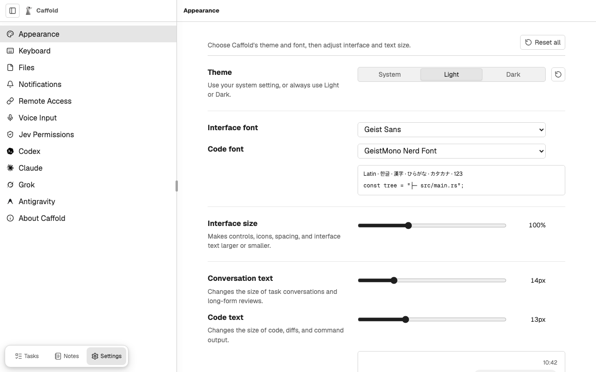
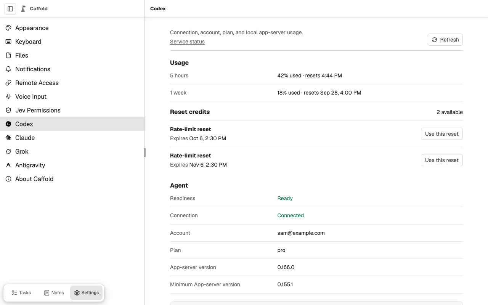
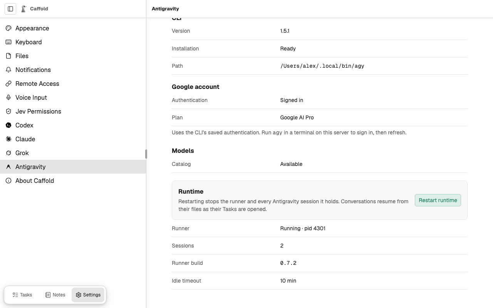

# Settings

Open **Settings** at the bottom of the navigation pane. What you set in
**Appearance**, **Keyboard**, and **Files** is saved in each browser;
everything else is saved on the Mac.

## Appearance

**Theme** is **System**, **Light**, or **Dark**. **Interface font**
and **Code font** choose the typefaces, with a sample below them. The code
fonts under **Nerd Fonts** also draw the icons and Powerline symbols that
terminal prompts use.
**Interface size** scales controls and interface text, while
**Conversation text** and **Code text** set the size of conversations and of
code, diffs, and command output. **Reset all** returns to the defaults.

## Keyboard

Turns **Keyboard navigation** on or off and lists its shortcuts. See
[Keyboard navigation](../keyboard.md).

## Files

Orders the file trees in Working Tree, Branch, Git, and GitHub: **Folders first**,
or **All entries by name**.

## Notifications, Remote Access, and Voice Input

- [Notifications](../get-started/notifications.md): this browser's notifications,
  and every browser that receives them.
- [Remote Access](../get-started/other-devices.md): the private address for your
  other devices.
- [Voice Input](../voice-input.md): how dictation becomes text.

## Jev Permissions

The TypeSafe API key and extra rules for **Ask Jev first**. See
[Ask Jev first](../tasks/ask-jev-first.md#set-it-up).

## Codex, Claude, and Grok

The Codex, Claude, and Grok pages open with your plan's usage as the agent reports it,
followed by what Caffold found: the installed version and path, the signed-in
account, and the state of the process Caffold talks to. **Service status**
opens the provider's status page, and **Refresh** reads everything again.
Status refreshes when you enter the page or return to the window. It does not
refresh periodically while you leave the page open; use **Refresh** to read it
again. Codex's newest release is checked on entry, return, Refresh, and after a
runtime restart or update.

- **Codex** also says how to fix an installation that is not ready, and offers
  **Restart runtime…** and **Update Codex…**. See
  [Updates](updates.md#codex).
- **Claude** offers **Restart runtime**. See
  [Updates](updates.md#claude-code-and-grok).
- **Grok** shows Caffold's Grok leader and the connection to it.

### Codex reset credits

When Codex has rate-limit reset credits, **Settings → Codex** lists them under
the usage, each with its expiry.

**Use this reset** asks Codex to use that credit to reset an eligible usage
limit. It asks for confirmation first, because a used credit cannot be
restored. If Codex counts credits it does not list, **Let Codex choose a reset**
uses one of those. If Caffold cannot confirm what happened,
**Retry previous reset request** sends the same request again, and Codex will
not use a second credit for it.

## Antigravity

Install the official ACP agent and manage Google sign-in here. Opening this
page checks the installation, account, plan, quota, and available models once
when the agent is installed and no setup, refresh or runtime restart is running.
The header **Refresh** repeats that check
using the existing ACP sign-in, without sending a model prompt. If Google
requires authentication, choose **Sign in** to begin it. Usage lists each
reported model group and period as a percentage used with the reset time in
your local timezone. **Service status** opens Google AI Studio status.

**Runtime** shows the runner's PID, build, held sessions and idle timeout.
**Restart runtime** asks for confirmation, then ends running Antigravity turns
and starts the installed runner binary. Saved conversations and Google sign-in
remain; open a Task to resume its conversation.

Installation, sign-in, refresh and restart progress update while the page is shown.
Follow [Set up Antigravity](../get-started/agents.md#antigravity) for the remote
Google completion-URL steps.

## About Caffold

**Updates** shows the version of Caffold, the newest release, and how the last
update ended. **Check for Updates** looks for a new release right away. When
Caffold can install one, the button becomes **Update Caffold**, which starts an
update; see [Updates](updates.md#caffold).
The page reads its server and update status on entry and when you return to
the window. These reads can use cached release information and do not repeat
periodically while the page stays open.

**This window** shows the build this window runs. **Reload to update** loads a
new version into this window, and **Copy diagnostics** copies the details to
include in a bug report.
