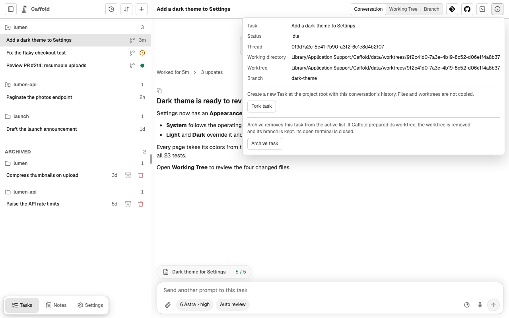

# Archive, restore, and delete

Archive a Task when you are done with it. Archived Tasks leave the active list
but can come back. Permanent deletion is also available from the error screen
of a verified broken worktree.

## Archive

Open the Task, choose **Task details** at its top right, and choose
**Archive task**.

- A Task that is still running cannot be archived; stop or finish its turn
  first.
- If the Task runs in a [worktree](worktrees.md) Caffold prepared, ordinary
  Archive requires no uncommitted changes, including new files Git does not ignore,
  such as [uploaded attachments](start-a-task.md#attach-files). Caffold then
  removes the worktree and keeps its branch.
- Caffold also asks the agent to archive or close its conversation. If the
  agent cannot be reached, the Task is archived anyway.
- The Task's [terminal](terminal.md) closes. **Task details** says so above
  **Archive task**.

## Discard changes and archive

If uncommitted changes or a broken worktree block Archive, **Task details**
offers **Discard changes and archive**. Review the folder in the confirmation
dialog before proceeding.

This deletes the worktree folder, including untracked and ignored files. The
conversation and Git branches are kept; discarded changes cannot be restored.
If Git is broken, [Restore may also fail](../reference/troubleshooting.md#an-archived-task-will-not-restore).

## Restore

Archived Tasks are listed under **Archived** at the bottom of the Task list.
The restore button on an archived Task's row returns it to the active list,
recreates its worktree from the kept branch, and reopens the same conversation.
Restore is available once the agent confirms that the conversation still
exists.

If a Task you have open is archived on another device, its conversation gives
way to **Task archived** and a **Restore** button that brings it back the same
way.

## Delete permanently

The delete button, a trash can on the same row, asks for confirmation, then
deletes the agent's conversation and Caffold's record of the Task. Your local
Git branch is kept. Deletion cannot be undone.

## Delete a broken worktree Task

If Caffold confirms that a worktree it prepared is missing or has lost its
Git metadata, the Task's error screen offers **Delete task**. Open that dialog,
read the Task name and folder path, and choose **Delete task** to confirm.
**Cancel** or Escape closes the dialog without deleting anything.

This permanently deletes the remaining worktree files, the agent conversation,
and Caffold's Task data. Caffold cannot check those files for uncommitted
changes. If the folder is already missing, the dialog says so; the
conversation and Task data are still deleted. Local Git branches are kept.
The Task and its worktree cannot be restored after deletion.

Deletion is withheld when Caffold cannot establish ownership or the checkout
has a repairable branch mismatch. Caffold rechecks before deleting, so an old
confirmation does not authorize deleting a worktree that is usable again.
