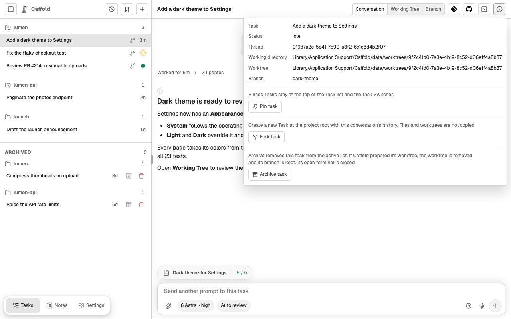
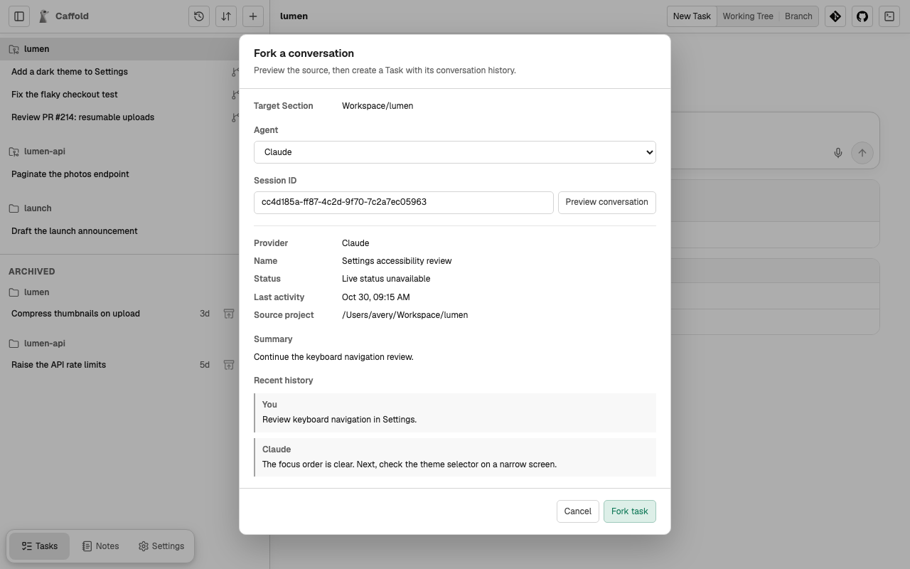

# Fork a conversation

Forking starts a new Task with the saved history of a Codex, Claude Code, or
Grok conversation. The child uses the same agent. Antigravity is not offered.

## Fork a Task

Open an idle Task, choose **Task details** at its top right, and choose
**Fork task**. The new Task, named `Fork of …`, opens in the same Section.

## Fork a conversation from outside Caffold

1. Select a Section to open it.
2. Under **Existing conversations**, choose **Fork conversation**.
3. Select the source agent. Enter its Thread ID (Codex) or Session ID
   (Claude or Grok). Codex also accepts a `codex://threads/…` link.
4. Choose **Preview conversation** and check the source name, status, working
   directory, and recent messages. Changing the agent or ID clears the preview.
5. Choose **Fork task**.

The child starts in the Section's directory. Preview reads the source without
resuming it or adding it to the Task list. A known active conversation cannot
be forked. **Live status unavailable** means Caffold can read saved history but
cannot confirm the external session's live status; it does not mean idle.
Caffold cannot prevent another external client from changing that source.

For Grok, use the native Session ID when entering an external source. A Task
that has moved to a worktree can run on a different native session than its
original Task ID. **Fork task** resolves the Task's current session for you.

## What a fork copies

The agent copies its own conversation history. Files, uncommitted changes,
branches, and worktrees are not copied; the child can
[move into a worktree](worktrees.md) like any other Task. The source remains
independent. Claude saves the child through its native local naming command,
without asking the model to reply.

If the child was created but could not be opened, retry opening that child.
If the connection failed before a creation result arrived, check the Task list
before submitting another fork.
