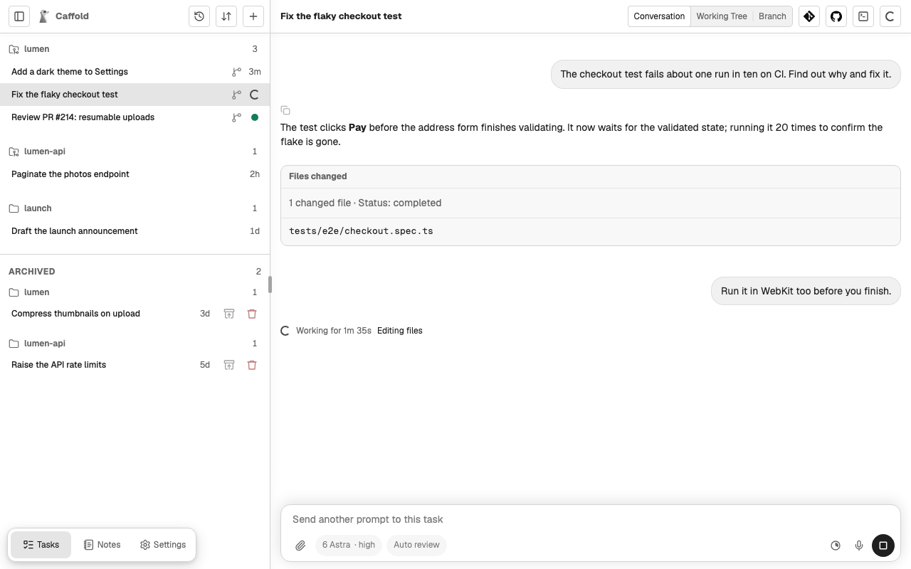

# Steer and stop

## Steer a running turn

Codex, Claude Code, Grok, and Antigravity accept more instructions while a turn
runs. Antigravity requires a pending permission to be answered, or the turn
stopped, before it accepts another prompt.

## Stop a turn

While a turn runs and the Composer is empty, the send button becomes
**Stop current turn**. The next input stays disabled while stopping.
Stopping keeps everything the agent already did.

When the agent confirms that prompts were canceled before it took them in,
they return to the Composer in the order you sent them, ahead of anything you
were typing, so you can send them again or discard them. Their **Attached files**
lists still name the files already uploaded; pictures are not attached again.
